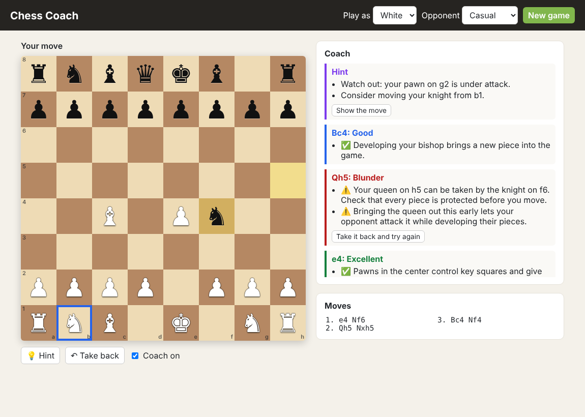

# Chess Coach

**▶ [Live demo](https://theoyanvno.github.io/chess-coach/)**

Play chess against a computer opponent that also **coaches you**. After every move, the coach grades it (Best, Excellent, Good, Inaccuracy, Mistake, Blunder) and explains why in plain language, then gives you a report at the end of the game.

**Tech:** JavaScript (ES modules) · Web Worker · HTML/CSS · `node:test` · no frameworks or dependencies



## Features

- **Move-by-move feedback.** The coach compares your move with the best move it can find and explains the difference:
  - "Your queen on h5 can be taken by the knight on f6. Check that every piece is protected before you move."
  - "You could have won material with Nxe5, capturing the pawn on e5."
  - "You had a forced checkmate starting with Ra8#. Look for checks first!"
  - Opening principles: developing pieces, controlling the center, castling, and avoiding early queen moves or knights on the rim
- **Take it back and try again** after a mistake or blunder, so you learn the right idea
- **Hints** that point out threats against your pieces and nudge you toward the best move before revealing it
- **Game report** with an accuracy score, a count of each grade, and one thing to focus on next game
- **Four opponent levels**, play as White or Black:
  - **Easy:** looks one move ahead and often picks a weaker move on purpose
  - **Medium:** looks two moves ahead with a little randomness
  - **Hard:** looks three moves ahead and always plays its best move
  - **Professional:** keeps searching deeper (up to five moves) until its 2.5-second budget runs out
- Full rules: castling, en passant, promotion (with a piece picker), check, checkmate, stalemate, the fifty-move rule, threefold repetition and insufficient material

## How it works

| File | What it does |
|---|---|
| [`src/engine.js`](src/engine.js) | Board representation, legal move generation, check detection, FEN and algebraic notation |
| [`src/ai.js`](src/ai.js) | Evaluation (material + piece-square tables), negamax search with alpha-beta pruning, move ordering, quiescence search, and iterative deepening with a time limit for the Professional level |
| [`src/coach.js`](src/coach.js) | Grades moves by how many centipawns they lose versus the best move, detects hanging pieces, missed captures and missed mates, and adds opening advice |
| [`src/worker.js`](src/worker.js) | Runs the engine in a Web Worker so the page never freezes while the computer thinks |
| [`src/ui.js`](src/ui.js) | Board rendering, click-to-move, coach feed, hints, take-backs and the game report |

The move generator is verified with **perft** tests against published node counts from the Chess Programming Wiki (for example, 97,862 positions at depth 3 from the "Kiwipete" test position), which exercises castling, en passant, promotions and pins.

## Run it

The game is a static site, but browsers only allow Web Workers over HTTP, so serve the folder instead of opening the file directly:

```bash
python3 -m http.server 8000      # then open http://localhost:8000
npm test                         # 12 tests (Node.js 18+)
```

It can also be published for free with GitHub Pages (Settings → Pages → deploy from the `main` branch).

## Ideas for next steps

- Puzzle mode built from your own mistakes
- Save games and track accuracy over time
- A transposition table so Professional can search even deeper

## Credits

- Built by Anthony Evo.
- Claude, Anthropic's AI assistant, made the AI learning tool: the coach that grades each move, explains it, gives hints and writes the game report.
- Built with help from AI coding tools for planning, code review and tests.
